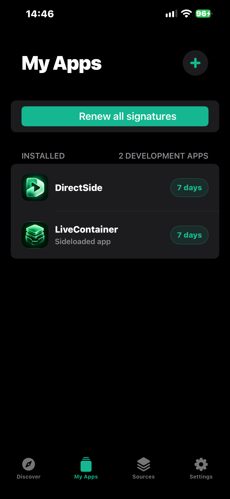
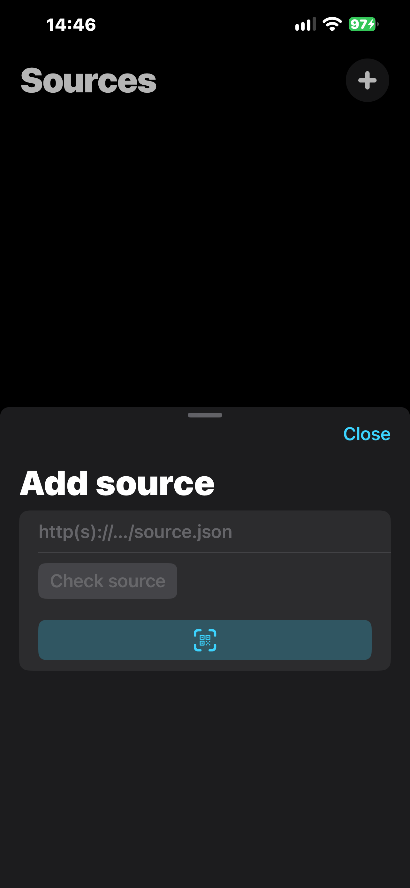

# DirectSide

Sideload with your own Apple ID. Set up your iPhone or iPad from Windows, then browse app sources, install IPAs and manage signatures on your device.

[Download for Windows](https://github.com/Serekay/directside/releases/latest/download/DirectSide.exe) | [Download IPA](https://github.com/Serekay/directside/releases/latest/download/DirectSide.ipa) | [Releases](https://github.com/Serekay/directside/releases)

## Windows and iPhone, together

- Automatic device detection, app icons and separate app-slot counts for each device.
- Local Apple sign-in with saved sessions and inline verification.
- One-button DirectSide installation, automatic USB pairing and setup repair. Install your own IPAs too.
- HTTP and HTTPS sources with QR import, descriptions, screenshots and updates.
- Install from sources or import an IPA on iPhone. Renew signatures and manage apps and certificates.
- Optional LiveContainer installation, with certificate preparation and a final setup handoff.
- Free and paid Apple Developer teams, or imported P12 certificates with matching provisioning profiles.
- English and German, with saved language preferences in both apps.
- Windows and iPhone update checks with verified downloads from published releases.

| My Apps | Add a source |
|:---:|:---:|
|  |  |

Actual iPhone captures. No personal account information, device identifiers or private source addresses are shown.

## Get started

1. Download and open **DirectSide.exe**. Connect your device by USB, unlock it and accept **Trust** if requested.
2. Sign in with your Apple ID and select your device. For an existing certificate, use **Settings > Install using > Change**, choose **Your own certificate**, then select the P12 file and matching `.mobileprovision` files.
3. Select **Install DirectSide**. It uses a current DirectSide IPA beside the Windows app, or downloads the published release. Pairing, the original IPA and signing files are transferred automatically. Use the **+** beside your device to install another IPA.
4. **Follow the Windows setup screen before opening DirectSide.** It detects whether Developer Mode is needed and prepares the switch automatically. On the iPhone, open **Settings > Privacy & Security > Developer Mode**, turn it on, restart, unlock and confirm **Turn On**. Windows checks the connection and finishes the transfer; do not reinstall the app. If USB remains disconnected after reconnecting the cable, select **Repair connection** in Windows. This restarts the Apple connection service and requires selecting **Yes** in the Windows permission prompt. Follow the on-screen instructions to trust your developer team under **Settings > General > VPN & Device Management**, then open DirectSide yourself. Windows does not navigate or launch apps on your iPhone. Distribution profiles may not require Developer Mode.
5. Open DirectSide and follow the short introduction. It opens the App Store if **LocalDevVPN** is missing. Install it, confirm its VPN setup and select **Connect**. If it is already connected, continue. The introduction also offers optional **LiveContainer** installation and can be skipped.
6. Add a source using **+** and choose an app. Your Windows sign-in is carried over automatically. If Apple requires another sign-in, use **Settings > Apple Account**.

On iPhone, pull down to refresh sources and swipe left to remove one. **My Apps** shows signature days remaining and updates on the affected app rows. Swipe left or touch and hold an installed app to delete it and its data; this frees a free-account app slot. Regular App Store apps remain managed by iOS. Windows also lists only sideloaded apps. **Settings** holds your account, signing method, language, connection and updates, plus **View introduction**. Developer Mode is guided in Windows before the first app launch. Windows help is under **?**.

For LiveContainer, install it from DirectSide. DirectSide stays open and prepares the certificate. Select **Complete setup** to open LiveContainer and hand over the certificate, then follow any confirmation shown there. **Set up later** explicitly skips this step; installation alone does not mean setup is complete. The certificate supports JIT-less operation; compatibility and certificate capabilities still matter. **Settings > LiveContainer > Transfer Certificate** is available to repeat an interrupted handoff.

## Requirements and limits

Windows and iOS/iPadOS **17 or later**. A free Apple ID allows **3 sideloaded apps per device**, **10 new App IDs per 7 days** and **7-day signatures**. DirectSide uses one app slot; LiveContainer uses another. Apple's certificate quota is separate: one certificate can sign multiple apps, and deleting an app does not revoke its certificate.

App IDs count registered identifiers, including app extensions, rather than installation attempts. To see names, extension ownership and expiry dates, click the App ID badge on Windows or open **Settings > App IDs** on iPhone. Updating or renewing the same app with the same Apple team reuses its identifier. DirectSide builds always use `com.directside.app`; account signing adds the same team suffix once. LiveContainer and SideStore extensions can each require additional App IDs.

Paid Apple Developer teams use their actual provisioning rules; DirectSide does not apply the free three-app limit to their profiles. Import currently supports RSA signing identities, matching the underlying signer. Imported certificates need a private key and valid profiles for the app, its extensions and this device (unless the profile allows all devices). Add multiple profiles when extensions use separate app IDs. Explicit profiles for unrelated apps cannot be used to sign DirectSide. Import validates the key/certificate match, certificate and profile dates and profile membership; the iPhone still verifies Apple's trust and revocation rules during installation. Importing does not require signing into the certificate provider.

Apple authentication runs locally. Your password is not saved; authentication sessions and signing keys use the system credential store. LocalDevVPN is a separate App Store app.

The iPhone updater is prepared for public DirectSide releases and needs no GitHub login or token. The repository remains private during development, so this updater currently reports that no public update is available. Windows also checks for published releases; its settings do not ask for a GitHub token. No repository credentials are bundled in the iPhone app. The iPhone checks at startup (at most every six hours) and offers an available update, or you can check manually in Settings. Updates are downloaded, checked against GitHub's size and SHA-256, signed and installed on the iPhone over LocalDevVPN. The verified new original IPA is retained for later renewal. You do not need to reconnect to Windows for each update. If DirectSide's signature has already expired and iOS cannot open it, open **Help** in Windows and choose **App won't open?** for the repair options.

## Project

The published release remains **0.1.0, build 5**. Test build **0.1.0, build 15** passed its private Actions build; it is not an update offered by the public-release updater. No new release has been published. The verified test IPA is available locally at `dist/DirectSide.ipa`. Keep it beside DirectSide.exe and use **Install DirectSide** to install it over the existing app with the same signing team. This normally preserves app data and reuses the existing App ID. Builds use the stable `com.directside.app` identifier.

Build 15 makes **Complete setup** the main LiveContainer onboarding action and replaces the misleading **Done** button with **Set up later**. The two iPhone screenshots above were captured from installed build 14; those views are unchanged in build 15. The Windows setup now guides developer-team trust without controlling the iPhone. Build success does not prove installation, self-update or guest-app compatibility; see [test status](docs/TESTSTATUS.md).

[Build guide](docs/DEVELOPMENT.md) | [Architecture](docs/ARCHITECTURE.md) | [Changelog](CHANGELOG.md) | [Third-party notices](THIRD_PARTY.md) | [License](LICENSE)
