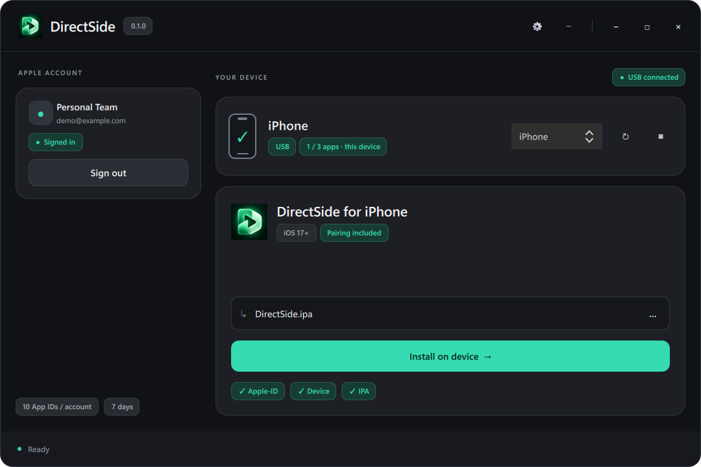
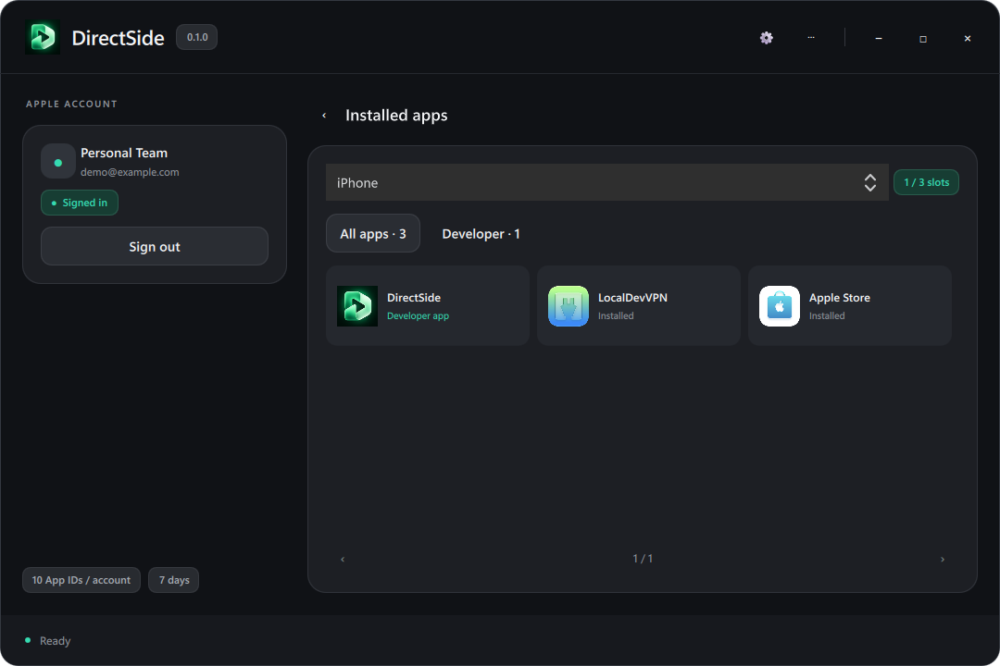

# DirectSide

Sideload with your own Apple ID. Set up your iPhone or iPad from Windows, then browse app sources, install IPAs and manage signatures on your device.

[Download for Windows](https://github.com/Serekay/directside/releases/latest/download/DirectSide.exe) | [Download IPA](https://github.com/Serekay/directside/releases/latest/download/DirectSide.ipa) | [Releases](https://github.com/Serekay/directside/releases)

## Windows and iPhone, together

- Automatic device detection, app icons and separate app-slot counts for each device.
- Local Apple sign-in with saved sessions and inline verification.
- One-button DirectSide installation, automatic USB pairing and setup repair. Install your own IPAs too.
- HTTP and HTTPS sources with QR import, descriptions, screenshots and updates.
- Install from sources or import an IPA on iPhone. Renew signatures and manage apps and certificates.
- Optional LiveContainer installation and signing-certificate transfer.
- English and German, with saved language preferences in both apps.
- Windows update notifications and verified downloads from releases.

| Windows setup | Installed apps |
|:---:|:---:|
|  |  |

*Screenshots use demonstration account and device data.*

## Get started

1. Download and open **DirectSide.exe**. Connect your device by USB, unlock it and accept **Trust** if requested.
2. Sign in with your Apple ID and select your device. Enable **Developer Mode** when prompted; the app explains the steps.
3. Select **Install DirectSide**. The latest released IPA is downloaded, signed and installed; pairing and signing files are transferred automatically. Use **Other IPA** for a local file.
4. Install **LocalDevVPN** using the displayed QR code and follow its setup instructions. Keep it connected for on-device signing and installation.
5. Open DirectSide on your device, sign in and add a source using **+**. Choose a normal installation or LiveContainer for supported apps.

On iPhone, pull down to refresh sources and swipe left to remove one. **My Apps** shows signature days remaining and renewal actions. **Settings** holds your account, language, connection, certificates and LiveContainer guide. Windows help is under **?**.

For LiveContainer, install it from DirectSide, transfer your certificate under **Settings > LiveContainer**, then run the **JIT-Less Mode** diagnostic in LiveContainer. Compatibility varies by app.

## Requirements and limits

Windows and iOS/iPadOS **17 or later**. A free Apple ID allows **3 sideloaded apps per device**, **10 new App IDs per 7 days** and **7-day signatures**. DirectSide uses one app slot; LiveContainer uses another. Apple's certificate quota is separate: one certificate can sign multiple apps, and deleting an app does not revoke its certificate.

Apple authentication runs locally. Your password is not saved; authentication sessions and signing keys use the system credential store. LocalDevVPN is a separate App Store app.

This repository is private. Release downloads require repository access. For downloads and updates inside Windows, save a repository-scoped GitHub token with **Contents: Read** under **Settings > Updates**. It is protected for your Windows user.

## Project

Version **0.1.0** includes iPhone build **5**. Windows and iPhone sign-in, installation and the complete USB setup transfer have been confirmed on hardware. Self-renewal and the LiveContainer JIT-less diagnostic still need device verification; see [test status](docs/TESTSTATUS.md).

[Build guide](docs/DEVELOPMENT.md) | [Architecture](docs/ARCHITECTURE.md) | [Changelog](CHANGELOG.md) | [Third-party notices](THIRD_PARTY.md) | [License](LICENSE)
