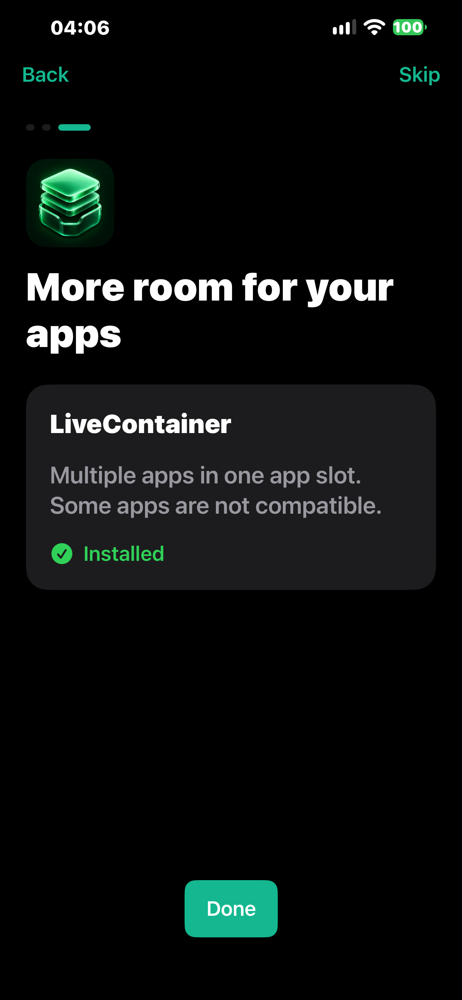

# DirectSide

Sideload with your own Apple ID. Set up your iPhone or iPad from Windows, then browse app sources, install IPAs and manage signatures on your device.

[Download for Windows](https://github.com/Serekay/directside/releases/latest/download/DirectSide.exe) | [Download IPA](https://github.com/Serekay/directside/releases/latest/download/DirectSide.ipa) | [Releases](https://github.com/Serekay/directside/releases)

## Windows and iPhone, together

- Automatic device detection, app icons and separate app-slot counts for each device.
- Local Apple sign-in with saved sessions and inline verification.
- One-button DirectSide installation, automatic USB pairing and setup repair. Install your own IPAs too.
- HTTP and HTTPS sources with QR import, descriptions, screenshots and updates.
- Install from sources or import an IPA on iPhone. Renew signatures and manage apps and certificates.
- Optional LiveContainer installation with automatic certificate transfer and JIT-less configuration.
- Free and paid Apple Developer teams, or imported P12 certificates with matching provisioning profiles.
- English and German, with saved language preferences in both apps.
- Windows and iPhone update checks with verified downloads from published releases.

| Windows setup | Installed apps |
|:---:|:---:|
|  |  |

*Windows screenshots use demonstration account and device data.*

| iPhone introduction | LiveContainer setup |
|:---:|:---:|
|  |  |

## Get started

1. Download and open **DirectSide.exe**. Connect your device by USB, unlock it and accept **Trust** if requested.
2. Sign in with your Apple ID and select your device. For an existing certificate, use **Settings > Install using > Change**, choose **Your own certificate**, then select the P12 file and matching `.mobileprovision` files.
3. Select **Install DirectSide**. It uses a current DirectSide IPA beside the Windows app, or downloads the published release. Pairing, the original IPA and signing files are transferred automatically. Use the **+** beside your device to install another IPA.
4. **Follow the Windows setup screen before opening DirectSide.** It detects whether Developer Mode is needed and prepares the switch automatically. On the iPhone, open **Settings > Privacy & Security > Developer Mode**, turn it on, restart, unlock and confirm **Turn On**. Windows detects the reconnect and finishes pairing automatically; do not reinstall the app. If requested, trust the developer profile under **Settings > General > VPN & Device Management**. Distribution profiles may not require Developer Mode.
5. Open DirectSide and follow the short introduction. It opens the App Store if **LocalDevVPN** is missing. Install it, confirm its VPN setup and select **Connect**. If it is already connected, continue. The introduction also offers optional **LiveContainer** installation and can be skipped.
6. Add a source using **+** and choose an app. Your Windows sign-in is carried over automatically. If Apple requires another sign-in, use **Settings > Apple Account**.

On iPhone, pull down to refresh sources and swipe left to remove one. **My Apps** shows signature days remaining and updates on the affected app rows. Swipe left or touch and hold an installed app to delete it and its data; this frees a free-account app slot. Regular App Store apps remain managed by iOS. Windows also lists only sideloaded apps. **Settings** holds your account, signing method, language, connection and updates, plus **View introduction**. Developer Mode is guided in Windows before the first app launch. Windows help is under **?**.

For LiveContainer, install it from DirectSide. After installation, DirectSide opens LiveContainer with the matching certificate; the certificate enables JIT-less automatically. When installing from Windows, open DirectSide on the iPhone to complete that handoff. **Settings > LiveContainer > Transfer Certificate** remains available to repair an interrupted handoff. The LiveContainer diagnostic is useful if a guest app fails to start; it is not an additional mode switch. Compatibility and certificate capabilities still matter.

## Requirements and limits

Windows and iOS/iPadOS **17 or later**. A free Apple ID allows **3 sideloaded apps per device**, **10 new App IDs per 7 days** and **7-day signatures**. DirectSide uses one app slot; LiveContainer uses another. Apple's certificate quota is separate: one certificate can sign multiple apps, and deleting an app does not revoke its certificate.

App IDs count registered identifiers, including app extensions, rather than installation attempts. To see names, extension ownership and expiry dates, click the App ID badge on Windows or open **Settings > App IDs** on iPhone. Updating or renewing the same app with the same Apple team reuses its identifier. DirectSide builds always use `com.directside.app`; account signing adds the same team suffix once. LiveContainer and SideStore extensions can each require additional App IDs.

Paid Apple Developer teams use their actual provisioning rules; DirectSide does not apply the free three-app limit to their profiles. Import currently supports RSA signing identities, matching the underlying signer. Imported certificates need a private key and valid profiles for the app, its extensions and this device (unless the profile allows all devices). Add multiple profiles when extensions use separate app IDs. Explicit profiles for unrelated apps cannot be used to sign DirectSide. Import validates the key/certificate match, certificate and profile dates and profile membership; the iPhone still verifies Apple's trust and revocation rules during installation. Importing does not require signing into the certificate provider.

Apple authentication runs locally. Your password is not saved; authentication sessions and signing keys use the system credential store. LocalDevVPN is a separate App Store app.

The iPhone updater is prepared for public DirectSide releases and needs no GitHub login or token. The repository remains private during development, so this updater currently reports that no public update is available. Windows also checks for published releases; its settings do not ask for a GitHub token. No repository credentials are bundled in the iPhone app. The iPhone checks at startup (at most every six hours) and offers an available update, or you can check manually in Settings. Updates are downloaded, checked against GitHub's size and SHA-256, signed and installed on the iPhone over LocalDevVPN. The verified new original IPA is retained for later renewal. You do not need to reconnect to Windows for each update. If DirectSide's signature has already expired and iOS cannot open it, open **Help** in Windows and choose **App won't open?** for the repair options.

## Project

The published release remains **0.1.0, build 5**. The current **0.1.0, build 14** test IPA is available locally at dist/DirectSide.ipa; its private build passed, and its fresh device test is pending. Keep it beside DirectSide.exe: the Windows **Install DirectSide** button uses that package when its version is at least the known release version, and shows its build number. No release was published. Earlier hardware checks covered Windows account handoff without another password, the introduction, LiveContainer installation over VPN, certificate handoff and its custom icon. Build 14 adds the LocalDevVPN instructions and keeps DirectSide open after LiveContainer installation; **Set up LiveContainer** explicitly opens it for certificate handoff. Signature renewal on iPhone reuses its stored original IPA; it does not fetch a new app version. Installing a new IPA over the existing app with the same signing team updates it while normally preserving its data. The self-updater, imported signing and LiveContainer guest compatibility still require owner verification; see [test status](docs/TESTSTATUS.md).

[Build guide](docs/DEVELOPMENT.md) | [Architecture](docs/ARCHITECTURE.md) | [Changelog](CHANGELOG.md) | [Third-party notices](THIRD_PARTY.md) | [License](LICENSE)
