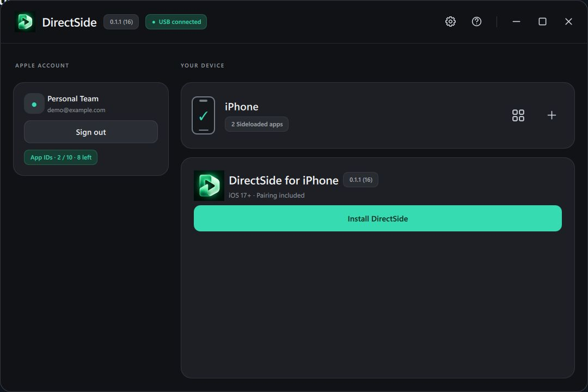
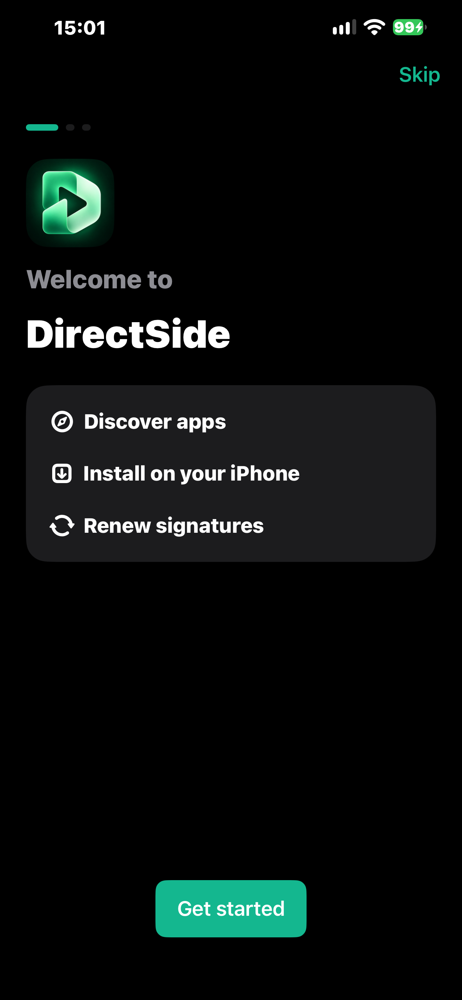
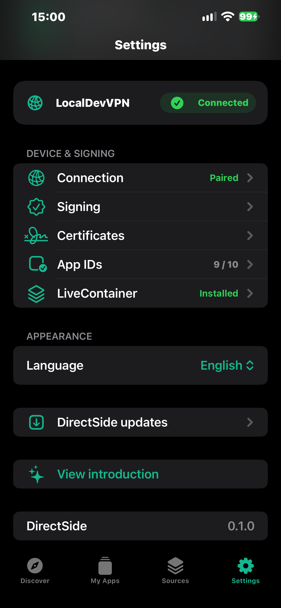

# DirectSide

Install iPhone apps with your own Apple account. Set up once from Windows, then install apps and renew signatures directly on your iPhone.

**Version 0.1.1 (16)**

[Download for Windows](https://github.com/Serekay/directside/releases/latest/download/DirectSide.exe) | [Download IPA](https://github.com/Serekay/directside/releases/latest/download/DirectSide.ipa) | [Releases](https://github.com/Serekay/directside/releases)

[Quick start](#quick-start) | [Setup](#setup) | [Screenshots](#screenshots) | [Troubleshooting](#troubleshooting)

## Quick start

You need a Windows PC, an unlocked iPhone or iPad running **iOS 17 or later**, a USB cable and an Apple account.

1. Open **DirectSide.exe**, connect your iPhone and confirm **Trust** on the phone if asked.
2. Sign in with your Apple account and select **Install DirectSide**.
3. Follow the Windows guide to enable **Developer Mode** and trust your developer team if required. Then open DirectSide on the iPhone.
4. Follow the iPhone introduction to install and connect **LocalDevVPN**. You can also set up **LiveContainer** or choose **Set up later**.
5. Open **Sources**, select **+** and add a source by address or QR code. Choose an app to install.

Your account is transferred from Windows. After setup, keep LocalDevVPN connected when installing, updating or renewing apps on the iPhone.

## What you can do

- Add app sources or import your own IPA files.
- View installed apps, signature expiry and available updates in **My Apps**.
- Renew signatures and remove apps by swiping left or touching and holding a row.
- Use LiveContainer for compatible apps that share one sideloaded app slot.
- Use a free or paid Apple Developer account, or import your own certificate.
- Check registered App IDs and switch between English and German.

## Setup

<strong>Enable Developer Mode and trust DirectSide</strong>

1. Install DirectSide through Windows first. This prepares the Developer Mode switch if it is not yet visible.
2. On the iPhone, open **Settings > Privacy & Security > Developer Mode** and enable it.
3. Restart the iPhone, unlock it and confirm **Turn On**.
4. Under **Settings > General > VPN & Device Management**, select your developer team and confirm **Trust**.
5. Open DirectSide yourself. Windows shows the instructions; it does not navigate your iPhone.

Follow the setup screen for your signing method. Some distribution profiles do not require Developer Mode or developer-team trust.

<strong>Connect LocalDevVPN</strong>

1. In the iPhone introduction, open the LocalDevVPN App Store page.
2. Install and open LocalDevVPN.
3. Follow its setup and allow the VPN configuration when iOS asks.
4. Select **Connect**, then return to DirectSide.

If LocalDevVPN is already connected, continue with setup. Its status is shown in DirectSide settings.

<strong>Set up LiveContainer</strong>

1. Select **Install LiveContainer** during the introduction.
2. Once installed, select **Complete setup**. This opens LiveContainer and hands over the certificate.
3. Follow any confirmation in LiveContainer, then return to DirectSide.

Choose **Set up later** to skip this step. To repeat the certificate handoff, open **Settings > LiveContainer > Transfer Certificate**.

<strong>Use an existing signing certificate</strong>

In Windows, open **Settings > Install using** and choose your own certificate. Select the **P12** file, enter its password and add the matching provisioning profiles.

The P12 must include the private key. The profiles must cover the app, any extensions and your device. You do not need to sign in to the certificate provider.

## Screenshots

<strong>Windows</strong>

<strong>iPhone</strong>

| Introduction | My Apps |
|:---:|:---:|
|  |  |

| Add a source | Settings |
|:---:|:---:|
|  |  |

## Updates and renewal

**Update DirectSide:** check **Settings** on the iPhone for a new version. The app also checks automatically at startup.

**Update from Windows:** keep the new `DirectSide.ipa` beside `DirectSide.exe` and select **Install DirectSide**. Use the same account and signing team to keep the existing installation and app data.

**Renew signatures:** open **My Apps** and renew before the remaining days run out. This extends the signature of the installed version.

## Accounts and limits

| Account | Installed apps | App IDs | Signature validity |
|---|---|---|---|
| Free Apple account | 3 sideloaded apps per device | 10 new App IDs per 7 days | 7 days |
| Paid developer account | Your team's provisioning rules | Your team's provisioning rules | Your signing profile |
| Imported certificate | Your signing profile | Your signing profile | Certificate and profile expiry |

DirectSide and LiveContainer each use one app slot. Updating the same app with the same team reuses its App ID. View registered IDs under **Settings > App IDs** on iPhone, or select the App ID badge in Windows.

## Troubleshooting

<strong>Windows does not detect my iPhone</strong>

1. Unlock the iPhone and connect it directly to the PC with a data-capable USB cable.
2. Confirm **Trust** on the iPhone if asked.
3. If DirectSide asks for Apple USB components, follow its setup guide.
4. If the connection was lost after restarting the iPhone, reconnect the cable once.
5. If it remains disconnected, select **Repair connection** in Windows.

The repair restarts the Apple connection service. Select **Yes** in the Windows permission prompt to allow it. Choosing **No** or closing the prompt cancels the repair. If repair still fails, restart the PC and reconnect the unlocked iPhone.

<strong>Developer Mode is missing</strong>

Keep the iPhone connected and install DirectSide through the Windows app first. Then check **Settings > Privacy & Security > Developer Mode** again and follow the Windows setup screen.

<strong>iOS says the developer is not trusted</strong>

Open **Settings > General > VPN & Device Management** on the iPhone. Select your developer team, confirm **Trust**, then open DirectSide again.

<strong>DirectSide or another app no longer opens</strong>

Its signature may have expired. If DirectSide still opens, connect LocalDevVPN and renew the affected app under **My Apps**.

If DirectSide itself cannot open, connect the iPhone to Windows and use **Help > App won't open?**. Keep the same Apple account and signing team.

<strong>Installing or renewing an app fails on iPhone</strong>

Open LocalDevVPN and check that it is connected. Return to DirectSide and check **Settings > Connection**. If you are asked to sign in again, open **Settings > Apple Account** and retry the operation.

<strong>I reached the app limit or App ID limit</strong>

**3 installed apps:** remove an unused sideloaded app from **My Apps** to free a slot.

**10 App IDs:** check **Settings > App IDs** for the registered identifiers and expiry dates. Removing an app does not immediately free an App ID. Wait for an ID to expire, or update an app that already uses an existing ID.

<strong>LiveContainer is installed but setup is not finished</strong>

Select **Complete setup** in the introduction, or open **Settings > LiveContainer > Transfer Certificate**. Follow any confirmation in LiveContainer. Not every app is compatible with LiveContainer.

<strong>No DirectSide update is shown</strong>

Check for updates in **Settings**. The updater offers newer published versions. Renewing signatures keeps the installed version; it does not install an update.

## Project links

[Build guide](docs/DEVELOPMENT.md) | [Architecture](docs/ARCHITECTURE.md) | [Changelog](CHANGELOG.md) | [Third-party notices](THIRD_PARTY.md) | [License](LICENSE)
